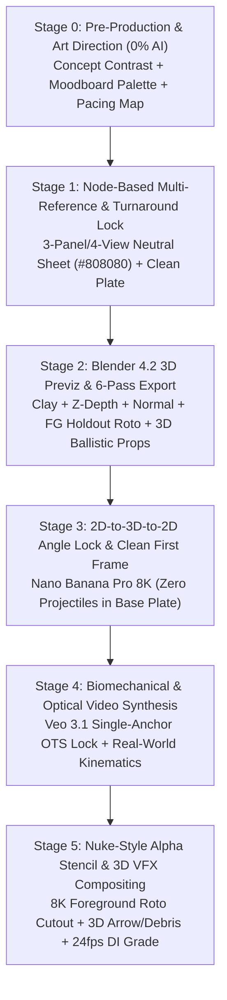

# 🎬 AI CINEMA & HYBRID VFX WORKFLOW GUIDE (V3.0 — STUDIO PRODUCTION STANDARD)

Tài liệu kiến trúc tổng thể kết hợp **Dây chuyền Hybrid 3D Blender 4.2 + Google Flow Ultra (`🍌 Nano Banana Pro` + `Veo 3.1`)** với các kỹ thuật thực chiến đúc kết từ:
1. **Weavy AI Node-Based Canvas & 2D-to-3D-to-2D Angle Re-projection** (`@taion_aiwork`)
2. **Kiến trúc Phần cứng NVMe I/O & Hybrid Live-Action/CGI Hook** (`@taion_aiwork` x Trương Huyền Đức — *SanDisk Optimus*)
3. **Quy trình 5 Bước Tiền Kỳ (0% AI Concept Conflict & Art Direction Moodboard)** (`@taion_aiwork` — *AIFLOW x FPD Academy Michelin F&B TVC*)
4. **Thực nghiệm Đối đầu VFX Truyền thống (Blender/Nuke) vs. AI VFX (`Seedream 5 Pro` / `Nano Banana Pro` / `Kling 3.0` / `Veo 3.1`)** (`ErikDoesVFX` — *"Is AI Actually Cheaper than VFX?"*)

---

## 🏗️ Kiến Trúc Tổng Thể 6 Giai Đoạn (End-to-End Hybrid Studio Pipeline)



---

## 🧭 STAGE 0: Tiền Kỳ, Xung Đột Ý Tưởng & Khóa Art Direction (0% AI)
> [!IMPORTANT]
> **Quy tắc từ Case Study TVC FPD Academy (`@taion_aiwork`):** Tuyệt đối không mở công cụ AI và gõ prompt ngay khi nhận đề bài. 80% sự khác biệt giữa "video AI nghiệp dư" và "TVC thương mại đẳng cấp" nằm ở 3 quyết định trước khi chạm vào AI:

1. **Xác định Xung đột Cốt lõi (Core Visual Contrast):**
   - Tìm ra 2 thái cực đối lập trong kịch bản để tạo lực đẩy thị giác.
   - *Ví dụ TVC F&B:* Sự chậm chạp, nặng nề của việc bày biện đạo cụ/đèn studio thủ công (`Thủ công`) $\leftrightarrow$ Sự bùng nổ, biến hóa tức thời của không gian ẩm thực bằng AI (`Dùng AI`).
   - *Ví dụ Phim ngắn Sinh tồn ([blender_previz_pipeline.py](file:///mnt/data/backup/project_personal/AI/blender_previz_pipeline.py)):* Sự tĩnh lặng căng thẳng của người thợ săn giương cung trong rừng sương mù (`0.0s–0.7s`) $\leftrightarrow$ Cú lao sấm sét phá vỡ không gian của khủng long T-Rex (`0.7s–3.0s`).
2. **Khóa Ngôn ngữ Thị giác & Moodboard (Art Direction Lock):**
   - Xác định rõ chất liệu ánh sáng, bảng màu và độ tương phản trước khi tạo ảnh:
     - *Fine-Dining / Luxury TVC:* Clean, Minimalist, High-Contrast Top-Light, nền đá tối, kim loại phản quang sắc nét.
     - *Prehistoric Thriller / Monster VFX:* Overcast Pacific Northwest Redwood Mist, Volumetric God-Rays, Cold Teal Shadows vs. Warm Amber Rim-Light.
3. **Bản đồ Nhịp độ Dựng (Pacing & Rhythm Map):**
   - Thiết kế điểm chuyển nhịp (Transition Trigger): Nhịp chậm tích tụ áp lực $\rightarrow$ Vật thể chuyển tiếp (Mở lồng bàn bạc / Buông dây cung bắn mũi tên) $\rightarrow$ Montage nhịp nhanh hoặc cú máy Handheld rung chấn theo bước chân.

---

## 🧩 STAGE 1: Tư Duy Node-Based Canvas & Bảng Tham Chiếu Đa Góc Độ (Weavy AI & `ErikDoesVFX`)

Thay vì gõ một đoạn prompt dài cầu may (khi sửa 1 chi tiết làm hỏng toàn bộ bức ảnh), mọi tài sản đầu vào phải được tách thành **các Node tham chiếu độc lập**:

| Node Đầu Vào | Vai trò trong Pipeline | Quy chuẩn Kỹ thuật |
| :--- | :--- | :--- |
| **Node 1: Character / Creature Turnaround Sheet** | Khóa giải phẫu nhân vật/sinh vật ở mọi góc độ | Ảnh `16:9` nền xám trung tính `#808080`, ánh sáng phẳng không bóng đổ, gồm **Toàn thân + Cận cảnh đầu/răng + Chi tiết bàn chân/móng vuốt** (chuẩn `velociraptor_reference_sheet` của `ErikDoesVFX` & `MEM-10`). |
| **Node 2: Clean Environment Plate** | Khóa bối cảnh rừng/studio gốc | `STRICTLY EMPTY ENVIRONMENT: zero people, zero creatures, zero floating props`. Giữ nguyên kết cấu vỏ cây, sương mù và hướng nắng. |
| **Node 3: 3D Camera & Depth Pass** | Khóa góc máy khó (OTS, Low-Angle, Dutch Tilt) | Xuất từ [blender_previz_pipeline.py](file:///mnt/data/backup/project_personal/AI/blender_previz_pipeline.py) (`frames_clay`, `frames_depth`) hoặc xoay mô hình 3D (`Meshy` / `.glb`) rồi chụp lại viewport đưa vào `🍌 Nano Banana Pro`. |
| **Node 4: Lighting & Relight Direction** | Khóa hướng sáng và độ tương phản | Tách biệt mô tả nguồn sáng chính (Key Light), ánh sáng ven (Rim Light) và sương mù quyển (Volumetric Fog). |

---

## ⚖️ STAGE 2: Ma Trận Phân Định Trách Nhiệm "3D VFX vs. AI" (Bài học từ `ErikDoesVFX`)

Thực nghiệm tiêu tốn ~`\$193` tiền credit AI (trên tổng giá trị thử nghiệm `\$10` – `\$1,000`) của `ErikDoesVFX` đã chứng minh **3 giới hạn vật lý mà AI Video hiện tại (`Veo 3.1`, `Kling 3.0`) thường xuyên làm hỏng**, buộc phải tách sang lớp **Blender 3D + Nuke/FFmpeg Compositing**:

| Bài toán Điện ảnh | Giao cho Thuần AI (Pure I2V/V2V) | Giao cho Hybrid (Blender 3D + AI + Alpha Stencil) | Giải pháp trong Codebase của chúng ta |
| :--- | :--- | :--- | :--- |
| **1. Đạo cụ nhỏ bay tốc độ cao (Mũi tên, Viên đạn, Mảnh vỡ)** | ❌ **Thất bại nặng:** AI vẽ mũi tên cong như cao su, bay lơ lửng ngang mõm khủng long, hoặc tự bịa ra cục lửa đỏ trên thân cây. | ✅ **Chuẩn 10/10:** Xóa sạch mũi tên khỏi ảnh AI gốc; render riêng mũi tên 3D (`frames_arrow_rgba`) bay đúng 0.4s (Frame 4–14) rồi ghép đè kèm Motion Blur. | Xem `arrow_col` trong [blender_previz_pipeline.py](file:///mnt/data/backup/project_personal/AI/blender_previz_pipeline.py#L237-L268) và `arrow_3d` overlay trong [build_studio_demo.py](file:///mnt/data/backup/project_personal/AI/build_studio_demo.py#L89-L91). |
| **2. Giữ nguyên Danh tính & Vị trí Diễn viên Tiền cảnh (Actor Identity Drift)** | ❌ **Thất bại nặng:** Khi AI tạo chuyển động cho khủng long, nó tự ý biến khuôn mặt diễn viên da trắng tóc vàng thành người châu Á tóc đen, hoặc làm thợ săn biến mất giữa chừng! | ✅ **Chuẩn 10/10:** Khóa **Single-Anchor First Frame** (không ép Last Frame lệch tỉ lệ) + Dùng **Foreground Roto Holdout Mask** để giữ nguyên diễn viên/cây cổ thụ tiền cảnh. | Xem `videoPrompt` trong [hybrid_3d_ai_bridge.mjs](file:///mnt/data/backup/project_personal/AI/hybrid_3d_ai_bridge.mjs#L74-L79) và `frames_fg_roto_mask` trong [blender_previz_pipeline.py](file:///mnt/data/backup/project_personal/AI/blender_previz_pipeline.py#L516-L523). |
| **3. Chuyển động Sinh vật Khổng lồ, Cơ bắp & Bụi đất (T-Rex / Rồng)** | ⚠️ Dễ bị trượt chân (moonwalk) nếu thiếu prompt cơ học. | ✅ **Thế mạnh tuyệt đối của AI:** Kết hợp khung xương 3D đa khớp (`TRex_Articulated_Rig`) + Prompt Sinh cơ học (`Biomechanical Kinematics`) trên `Veo 3.1`. | Xem `TRex_Articulated_Rig` trong [blender_previz_pipeline.py](file:///mnt/data/backup/project_personal/AI/blender_previz_pipeline.py#L271-L478) & hàm `build_biomechanical_veo_prompt` trong [blender_studio_library.py](file:///mnt/data/backup/project_personal/AI/blender_studio_library.py). |
| **4. Giữ nguyên Pixel Cây cối Tiền cảnh (Background/Plate Lock)** | ❌ AI vẽ lại toàn bộ vỏ cây và làm lệch chiều sâu không gian. | ✅ **Alpha Stencil Cutout:** Dùng mặt nạ 3D Roto (`roto_%04d.png`) cắt chính lớp vỏ cây 8K thật từ ảnh AI (`ai_neural_frame_0001_clean.jpg`) đè lên tiền cảnh. | Xem chuỗi filter `alphamerge` trong [build_studio_demo.py](file:///mnt/data/backup/project_personal/AI/build_studio_demo.py#L80-L88). |

---

## 🦖 STAGE 3 & 4: Công Thức "Biomechanical & Optical Prompting" Cho Veo 3.1 / Kling 3.0

Khi điều khiển các sinh vật hoặc cảnh hành động nặng trên `Veo 3.1`, không bao giờ viết prompt chung chung kiểu *"a dinosaur runs toward the camera"*. Bắt buộc áp dụng cấu trúc **4 Lớp Sinh Cơ Học & Quang Học** (được chuẩn hóa trong hàm [`build_biomechanical_veo_prompt`](file:///mnt/data/backup/project_personal/AI/blender_studio_library.py)):

1. **`[CAMERA & FOREGROUND LOCK]`**: Khóa tiêu cự ống kính (ví dụ: `35mm Anamorphic Cinema Lens`), khóa vị trí máy quay (`locked stationary tripod / handheld micro-shake behind the hooded ranger on screen-left`), cấm camera tự ý bay xuyên qua làm mất nhân vật tiền cảnh.
2. **`[BIOMECHANICAL KINEMATICS]`**: Tham chiếu cơ học của các loài động vật có thật ngoài đời (ví dụ: *"combining the heavy charging biomechanics of a cassowary, ostrich, and Komodo dragon; its torso rolls with weight transfer as muscular three-toed feet crush into the moist forest mud"*).
3. **`[OPTICAL & SHUTTER PHYSICS]`**: Khóa hiệu ứng quang học thực tế (`180-degree cinema shutter drag, natural motion blur on fast-moving limbs, elliptical anamorphic bokeh, volumetric mist displacement`).
4. **`[NEGATIVE / EXCLUSION GUARDRAILS]`**: Cấm vật thể bay giả tạo hoặc biến dạng danh tính (`Zero floating arrows, zero morphing faces, zero disappearing foreground characters, 100% photorealistic live-action physics`).

---

## 💻 STAGE 5: Tối Ưu Hóa Phần Cứng Local AI & Hậu Kỳ DI (Insight từ `@taion_aiwork` x SanDisk Optimus)

Để vận hành trơn tru dây chuyền kết hợp **Blender 4.2 (xuất 6 chuỗi PNG 72–192 frames)** + **Local AI / Google Flow Bridge** + **FFmpeg Multi-Input Compositing**:
- **Quản lý Scratch Disk tốc độ cao (NVMe I/O):** Toàn bộ thư mục trung gian (`frames_clay`, `frames_color`, `frames_depth`, `frames_normal`, `frames_fg_roto_mask`, `frames_arrow_rgba`) và các model `.glb` / checkpoint AI cần đặt trên phân vùng SSD NVMe tốc độ cao để tránh nghẽn I/O khi đọc/ghi đồng thời 5–6 luồng ảnh RGBA không nén.
- **Kiểm soát Ngân sách Credit AI (Cost Guardrail):**
  - Luôn duyệt **Clean First Frame 8K** (`0 Credit` với `🍌 Nano Banana Pro`) và **3D Clay/Roto Previz** (`0 Credit` với Blender 4.2 Workbench) trước khi gọi `Veo 3.1`.
  - Việc khóa góc máy bằng Blender 3D + tách riêng đạo cụ bay (mũi tên) ra khỏi prompt tạo video giúp tỷ lệ ăn ngay (First-Try Success Rate) trên `Veo 3.1` đạt chuẩn sản xuất mà không phải tốn hàng trăm đô-la bấm tạo lại như quy trình thuần AI.

---

## 🚀 Lệnh Chạy Nhanh Toàn Bộ Dây Chuyền Trong Workspace

```bash
# 1. Chạy toàn trình: Blender 4.2 (6-Pass 3D) -> Google Flow Ultra Bridge (Veo 3.1) -> Nuke-Style FFmpeg Compositor
node /mnt/data/backup/project_personal/AI/hybrid_3d_ai_bridge.mjs

# 2. Chỉ dựng lại 6 Pass 3D từ Blender 4.2 (Clay, Color, Depth, Normal, Roto Mask, 3D Ballistic Arrow)
/mnt/data/backup/project_personal/AI/tools/blender-4.2.3-linux-x64/blender -b -P /mnt/data/backup/project_personal/AI/blender_previz_pipeline.py

# 3. Chạy bàn dựng Alpha Stencil Cutout + 3D Arrow Overlay + 46Hz LFE Audio + 2.39:1 CinemaScope DI Grade
python3 /mnt/data/backup/project_personal/AI/build_studio_demo.py
```

